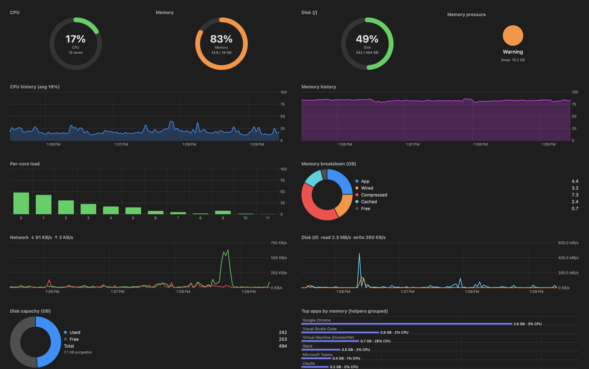
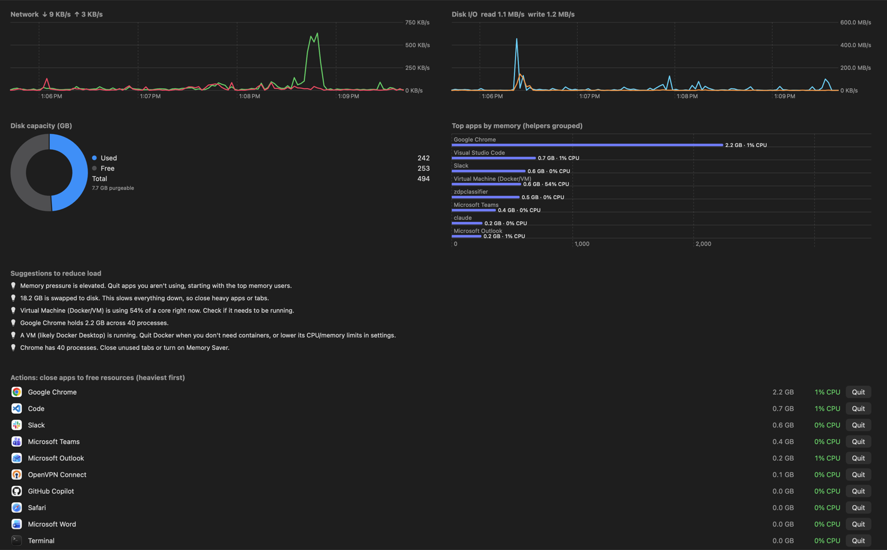

# Resource Monitor

[](https://github.com/pradeep-kaloori/resource-monitor/actions/workflows/build.yml) [](LICENSE)

A lightweight, native macOS app that continuously monitors your Mac's resources, shows them with live graphics, and tells you what to close to reduce load. Built with SwiftUI and Swift Charts, with no third-party dependencies.





## Features

- **Ring gauges** for CPU, memory and disk, plus a memory-pressure indicator and swap usage
- **Live history charts** for CPU and memory (last 4 minutes, 2-second refresh)
- **Per-core CPU load** bars
- **Memory breakdown** donut: app, wired, compressed, cached, free
- **Network** upload and download throughput
- **Disk metrics**: live read/write throughput chart, used/free/purgeable capacity donut, and a heavy-write warning
- **Top apps by memory**, with helper processes (Chrome, Slack, Docker VM) grouped under their parent app
- **Actions panel**: heaviest running apps with icons and a Quit button (asks first; graceful quit or force quit)
- **Suggestions panel** that turns live numbers into actions, such as "Quit Docker when you don't need containers"
- **Menu bar readout** (`CPU % MEM %`) so you can see load without opening the window

## Advantages

- **Finds the real culprit.** Grouping helper processes shows that "Chrome" is 3 GB, not 40 separate 80 MB entries.
- **Actionable.** It suggests what to do instead of only showing numbers.
- **Light.** Native Swift calls the Mach and sysctl APIs directly. It is not an Electron app, and it uses minimal CPU itself.
- **Private.** Everything runs locally. No network calls, no telemetry, no accounts.
- **Simple to build.** One Swift package and one script, with no Xcode project required.
- **Easy to hack.** About 400 lines of readable code in two files.

## Requirements

- macOS 14 (Sonoma) or later
- Swift 5.9+ toolchain (Xcode or Command Line Tools: `xcode-select --install`)

## Install and use

No toolchain? Download the prebuilt app from [Releases](https://github.com/pradeep-kaloori/resource-monitor/releases), unzip it, then right-click and choose **Open** on first launch.

Or build from source:

```bash
git clone https://github.com/pradeep-kaloori/resource-monitor.git
cd resource-monitor
./build.sh
open ~/Applications/"Resource Monitor.app"
```

`build.sh` compiles a release build, wraps it into `Resource Monitor.app`, ad-hoc signs it, and copies it to `~/Applications`.

If macOS blocks the first launch, right-click the app and choose **Open**.

To run without installing: `swift run -c release`.

## Project layout

```
Package.swift                         Swift package manifest
build.sh                              Builds and installs the .app bundle
Sources/ResourceMonitor/Sampler.swift Data collection (CPU, memory, disk, network, processes, tips)
Sources/ResourceMonitor/App.swift     SwiftUI dashboard, charts, menu bar item
```

## Contributing

Contributions are welcome. See [CONTRIBUTING.md](CONTRIBUTING.md) and the [good first issues](https://github.com/pradeep-kaloori/resource-monitor/labels/good%20first%20issue).

1. Fork the repo and create a branch: `git checkout -b feature/my-change`
2. Make your change and verify it builds: `./build.sh`
3. Launch the app and check the dashboard visually
4. Commit with a clear message and open a pull request describing what and why

Ideas:

- GPU and battery/thermal stats
- Biggest folders by size (disk usage drill-down)
- Per-process disk I/O
- Configurable refresh interval and alert thresholds with notifications
- Launch at login
- Unit tests for process grouping and tip rules

Please keep the app dependency-free and keep the sampling overhead low. Open an issue first for large changes.

## License

MIT. See [LICENSE](LICENSE).
